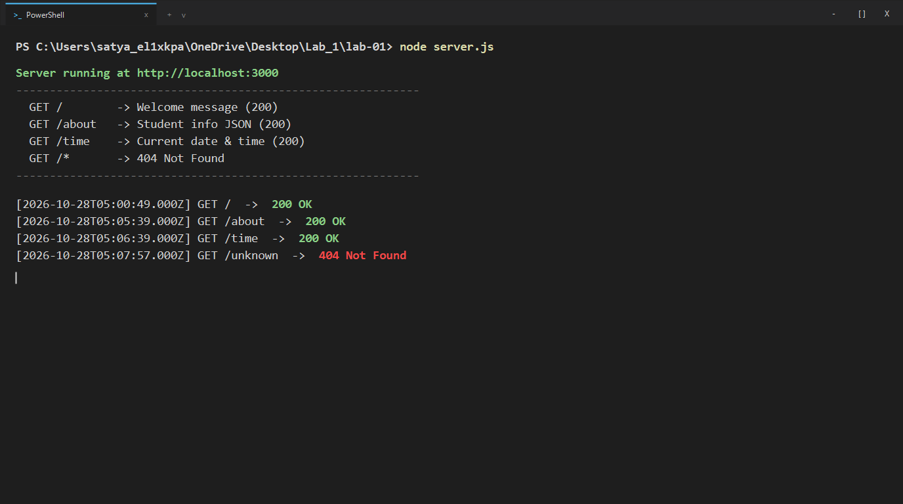
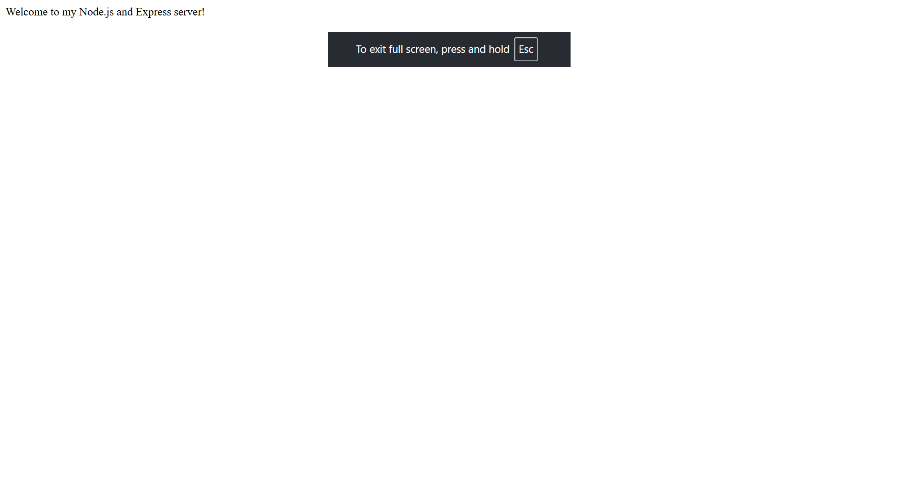
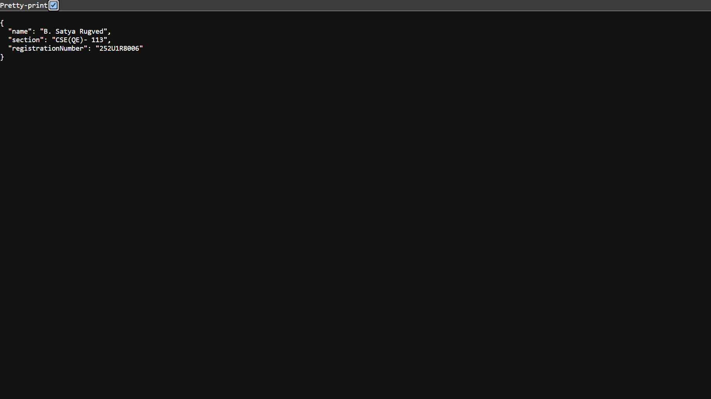
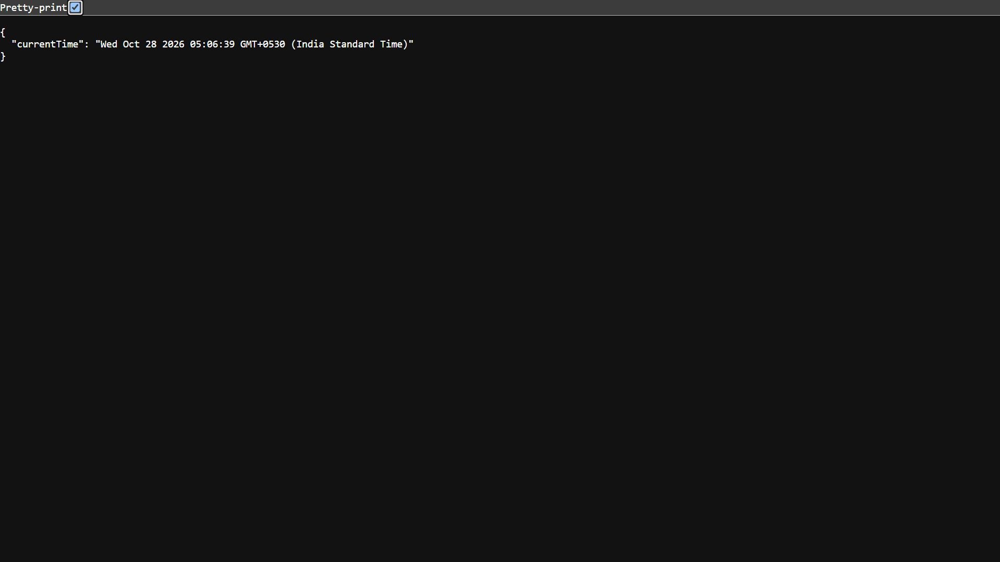

# Lab 1: Node.js and Express Server

> **Course:** Backend Development Fundamentals · Year II Term II · Aurora  
> **Faculty:** Shiva Sai Teja  

---

**Live Link:** [https://your-app.onrender.com](https://your-app.onrender.com) *(Replace with your deployed URL after deployment)*

---

## Student Details

| Field               | Value              |
|---------------------|--------------------|
| **Name**            | B. Satya Rugved    |
| **Registration No.**| 252U1R8006         |
| **Section**         | CSE(QE-2A) 113     |

---

## How to Run

### Requirements
- [Node.js](https://nodejs.org/) v18 or above
- npm (comes with Node.js)

### Installation & Start

```bash
# 1. Clone the repository
git clone https://github.com/Lucky15-Tech/backend-lab-1.git
cd backend-lab-1/lab-01

# 2. Install dependencies
npm install

# 3. Start the Express server
npm start
# Server runs at http://localhost:3000

# (Optional) Run the plain http server
node http-server.js
# Runs at http://localhost:3001
```

### Environment Variables

No `.env` file is needed for this lab. The port defaults to `3000`.

If deploying, you may set:

```
PORT=3000
```

> ⚠️ **Never commit your `.env` file.** It is listed in `.gitignore`.

---

## Project Structure

```
lab-01/
├── server.js         ← Express server (main entry point)
├── http-server.js    ← Plain Node.js http module server
├── basic-server.js   ← Simple HTTP server
├── package.json      ← Project metadata and dependencies
├── .gitignore        ← Excludes node_modules and .env
├── screenshots/      ← Browser and terminal screenshots
│   ├── terminal.png
│   ├── route_root.png
│   ├── route_about.png
│   ├── route_time.png
│   └── route_404.png
└── README.md         ← This file
```

---

## Endpoints

| Method | Path       | Status | Description                                      |
|--------|------------|--------|--------------------------------------------------|
| GET    | `/`        | 200    | Returns a plain-text welcome message             |
| GET    | `/about`   | 200    | Returns JSON with student name and section       |
| GET    | `/time`    | 200    | Returns current date and time using `new Date()` |
| GET    | `/*`       | 404    | Returns error for any unknown route              |

---

## package.json Field Explanations

| Field          | Meaning                                                                 |
|----------------|-------------------------------------------------------------------------|
| `name`         | The name of your project (lowercase, no spaces)                        |
| `version`      | Current version of your app (follows semantic versioning: major.minor.patch) |
| `description`  | Short description of what the project does                             |
| `main`         | Entry point file Node.js will run (`server.js`)                        |
| `scripts`      | Shortcut commands (`npm start` runs `node server.js`)                  |
| `keywords`     | Tags to help others find your package on npm                           |
| `author`       | Your name                                                               |
| `license`      | How others can use your code (`ISC` = permissive open source)          |
| `dependencies` | External packages your app needs to run (e.g., `express`)              |

---

## Screenshots

### ▶ Terminal – Server Start


---

### 1. GET / – Welcome Route (200 OK)


---

### 2. GET /about – Student Info (200 OK)


---

### 3. GET /time – Current Time (200 OK)


---

### 4. GET /unknown – 404 Not Found


---

## Viva Q&A

**Q: What is the difference between `package.json` and `node_modules`?**  
> `package.json` is a configuration file that lists your project's metadata and the packages it depends on. `node_modules/` is the actual folder where those packages are downloaded and stored by npm. You commit `package.json` but **never** commit `node_modules/`.

**Q: What does `app.listen` do?**  
> `app.listen(PORT, callback)` binds the Express app to a network port and starts the HTTP server. It tells the OS: "Listen for incoming TCP connections on this port." The optional callback runs once the server is ready.

**Q: What do `request` and `response` represent?**  
> - **`request (req)`**: Represents the incoming HTTP request. It contains the URL, HTTP method, headers, query parameters, and body sent by the client (browser).  
> - **`response (res)`**: Represents the outgoing HTTP response. It has methods like `res.send()`, `res.json()`, and `res.status()` to send data back to the client.

---

## Notes

### Problems Faced & Solutions

| Problem | Solution |
|---------|----------|
| `npm` not found in PATH | Installed Node.js from [nodejs.org](https://nodejs.org) and reopened terminal |
| Port 3000 already in use | Changed port to 3001 for the plain http server |
| 404 handler must be last | Moved `app.use()` 404 handler after all route definitions |

---

*Lab 01 — Backend Development Fundamentals | Aurora College*

